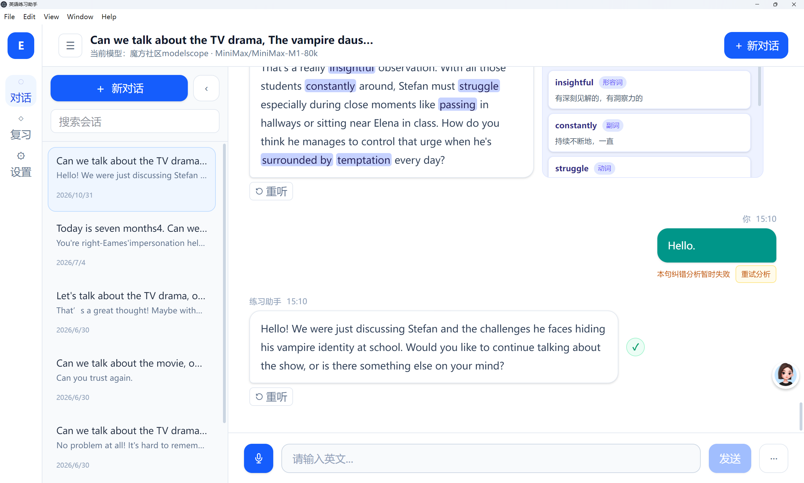
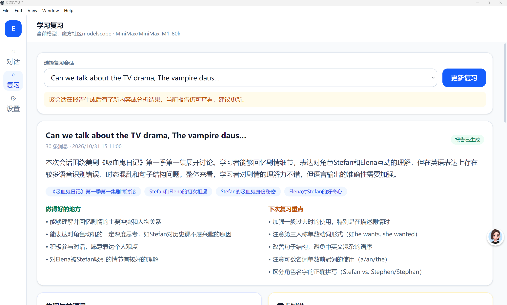

# 英语练习助手

基于 Electron 的本地英语口语练习工具，支持大模型对话、离线语音识别与朗读、对话保存、纠错、生词和学习复习。

## 界面预览

### 对话练习

历史会话、生词高亮与释义、语音输入和回复重听。



### 学习复习

按会话回顾学习内容，查看对话总结、表达优点和下一步复习重点。



## 本地开发

需要 Node.js 22 和 Windows x64。

```sh
npm ci
npm run rebuild:native
npm run dev
```

大模型服务由用户在设置中自行配置。项目不提供或内置个人 API Key。

## 字幕功能的公开范围

公开代码包含本地字幕导入、字幕包解压、按集剧情总结、知识库管理与对话知识检索。
字幕网站爬虫、站点会话、验证码识别、站点默认地址及解析测试属于独立私有扩展，不在公开仓库和默认公开构建中。

没有私有扩展也能构建并使用本地字幕功能。在设置中打开字幕知识库，填写作品与季集，选择“导入本地字幕”。支持 SRT、ASS、SSA、VTT、ZIP、RAR 和 7z。

```sh
npm run typecheck
npm test
npm run build
npm run dist:portable
npm run dist:win
```

`npm run build` 强制使用社区版来源接口，并自动检查产物是否误含私有实现。

## 维护私有开发目录

完整开发目录的 `private/subtitle-sources/` 单独保管，已被 Git 忽略。本地存在扩展时 `npm run dev` 自动加载；`npm run dev:community` 可检查公开版行为。私有测试、私有构建和私有打包命令仅供完整工作区使用，详见 [发布说明](docs/public-release.md)。

准备 GitHub 源码时执行：

```sh
npm run export:public
```

仅将命令输出的 `public-source/english-practice-community-...` 目录初始化为公开仓库。导出使用文件白名单，不包含旧 Git 历史、私有模块、配置、个人对话、日志、模型、字幕或历史安装包。

## 许可证

本项目自行编写的公开代码采用 [PolyForm Noncommercial License 1.0.0](LICENSE)，属于源码可用软件。
允许按许可证规定进行非商业使用、修改和分发；超出许可证许可范围的商业用途，需要另外获得项目权利人的授权。具体用途和非商业组织的例外以许可证原文为准。

本许可不包含私有字幕扩展，也不改变第三方依赖、移植代码、模型、字幕或词典内容的原有授权。
